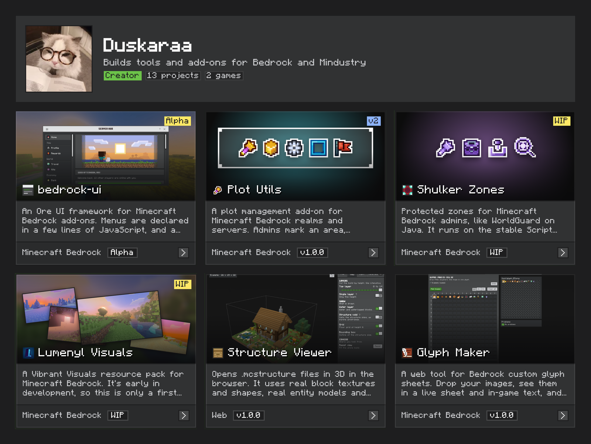
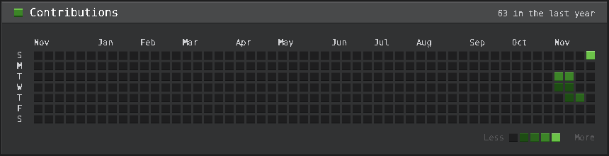

# Duskaraa

Tools and add-ons that make building for Minecraft Bedrock a little easier.

**Portfolio:** https://duskaraa.github.io

## About

Most of what I make started as something I needed for my own projects. If it helps you too, feel free to use it, and feedback is always welcome.
In search of the incredible.

Commissions are closed for now, my time goes to my own projects.

## What I do

- Script API add-ons (JavaScript / TypeScript)
- JSON UI and resource packs
- Web tools for creators
- Mindustry projects

## Projects

- bedrock-ui: JSON UI framework (in development)
- [ShulkerDB](https://github.com/Duskaraa/shulkerdb)
- [Shulker Commands](https://github.com/Duskaraa/shulker-commands)
- [Mirai](https://github.com/Duskaraa/mirai): Mindustry mining AI
- Web tools: [Nineslice Editor](https://duskaraa.github.io/nineslice-editor/) ([repo](https://github.com/Duskaraa/nineslice-editor)), [Structure Viewer](https://duskaraa.github.io/structure-viewer/) ([repo](https://github.com/Duskaraa/structure-viewer)), [Manifest Builder](https://duskaraa.github.io/manifest-builder/) ([repo](https://github.com/Duskaraa/manifest-builder)), [Recipe Builder](https://duskaraa.github.io/recipe-builder/) ([repo](https://github.com/Duskaraa/recipe-builder)), [Glyph Maker](https://duskaraa.github.io/glyph-maker/) ([repo](https://github.com/Duskaraa/glyph-maker))

## Languages

## Contribution activity

